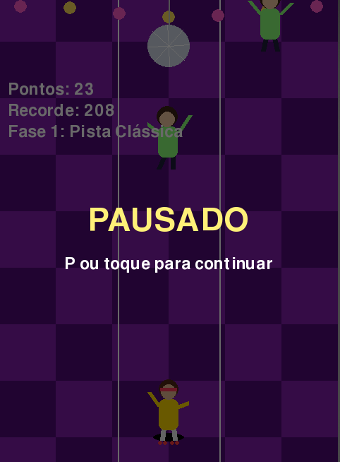

# 🕺 Disco Roller

Jogo *endless runner* ambientado numa pista de **roller disco dos anos 70**.
Você controla um patinador que desvia dos dançarinos ao som de música de discoteca.
Feito em **Python + Pygame**.



## Como jogar

- **← / → (ou A / D):** troca de faixa
- **Espaço (ou ↑ / W):** pula as caixas de som
- **Enter:** começa ou reinicia
- Passar perto de um dançarino sem encostar dá **pontos de estilo**

## Fases

| Fase | Cenário | Música |
|---|---|---|
| 1. Pista Clássica | Piso roxo, luzes rosa e amarelas | 110 BPM |
| 2. Neon Club | Piso azul, luzes néon | 120 BPM |
| 3. Bola de Espelhos | Piso dourado, luzes vermelhas | 130 BPM |
| 4. Space Disco | Piso índigo com estrelas, luzes ciano e rosa | 140 BPM |
| 5. Calçadão ao Pôr do Sol | Piso laranja e rosa, sol retrô | 115 BPM |
| 6. Boate de Gelo | Piso azul-gelo com neve | 125 BPM |
| 7. Carnaval 70 | Piso verde e azul com confete | 150 BPM |

A fase muda a cada 30 segundos, e a velocidade aumenta com o tempo.

## Como rodar

```bash
git clone https://github.com/ismaelfdeoliveira/disco-roller-game.git
cd disco-roller-game
python3 -m venv venv
source venv/bin/activate
pip install pygame-ce numpy
python disco_roller.py
```

## Destaques técnicos

- **Física com inércia:** a troca de faixa usa uma mola amortecida, então o patinador derrapa um pouco
- **Obstáculos no ritmo:** dançarinos e caixas de som aparecem a cada batida da música
- **Música sintetizada por código:** bumbo, chimbal, baixo e acordes gerados com NumPy, sem arquivos de áudio nem problemas de licença
- **Recorde salvo** em arquivo local
- Estrutura compatível com Pygbag (`asyncio`), para publicar no navegador no futuro

## Sobre o projeto

A ideia do jogo (roller disco, sete fases com cenários e músicas próprios) é minha.
Usei IA generativa como ferramenta de desenvolvimento e depois estudei e ajustei o código.

**O que eu mudei e aprendi:**
- Defini o conceito (roller disco anos 70), as sete fases com cenários e músicas próprios e a ordem de prioridade das melhorias, e testei cada etapa jogando.
- Montei o ambiente no Debian (ambiente virtual e pygame-ce), aprendi a aplicar patches, a usar o Git com token de acesso e a resolver erros de áudio e de autenticação.

## Autor

Ismael Francelino de Oliveira
GitHub: [@ismaelfdeoliveira](https://github.com/ismaelfdeoliveira)
